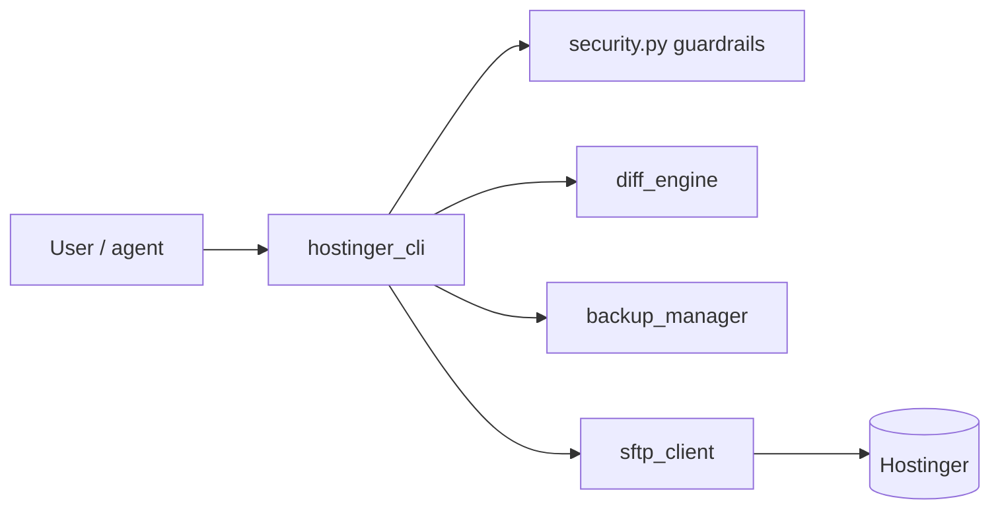

# Hostinger SFTP CLI Agent

A Python command-line tool for managing hosting files over SFTP. It is built with guardrails because an AI agent may drive it: writes stay inside allowed roots, protected files are immutable, and nothing is uploaded without a diff and explicit confirmation.

**Why:** an agent that edits live website files needs hard limits, not prompts. Each rule below is enforced in code and covered by tests.

## Key features
- **Root confinement** against path traversal, with a deny-list for secrets, keys, certificates, archives and backups.
- **Pre-write flow:** download, SHA-256 check, dated local backup, colored unified diff, explicit confirmation.
- **Concurrency check:** the remote file must be unchanged between read and write.
- **Atomic upload:** temp file then rename, only after size and hash verification.
- **Multi-domain** support through `--domain` / `-d`.
- **No secret output:** passwords and keys are never printed.

## Architecture


## Commands
| Command | What it does |
|---|---|
| `status` | Checks the SFTP connection, host key fingerprint and allowed root |
| `list [path]` | Lists remote files and folders |
| `get <remote> [local]` | Downloads a file |
| `diff <remote> <local>` | Unified diff between remote and local versions |
| `backup <remote>` | Dated local backup, hash recorded in the manifest |
| `put <local> <remote>` | Diff, confirm, back up, then upload atomically (`--yes` skips the prompt) |
| `edit <remote>` | Downloads, opens your editor, shows the diff on save, uploads after confirmation |
| `backups` | Lists local backups from `backups_manifest.jsonl` |

## Structure
| Path | What it is |
|---|---|
| [hostinger_cli/](hostinger_cli/README.md) | Package: CLI, SFTP client, security rules, config, backups, diffs |
| [tests/](tests/README.md) | pytest suite for security, config, backups and CLI workflows |
| `.env.example` | Public template with variable names and no secrets |

## Run
```bash
pip install -r requirements.txt
cp .env.example .env          # fill in your own host, user, agent password and root
python -m hostinger_cli --help
python -m pytest -v
```
Required variables are the SFTP host, port, username, a dedicated agent password, the target domain, the allowed roots and the backup directory. `.env` is git-ignored.

## Status
🟡 The unit suite passes (20 tests, SFTP calls mocked). It has not been exercised against a live host in this copy.

---

Built by Monoga · [github.com/Monoga2025](https://github.com/Monoga2025)
