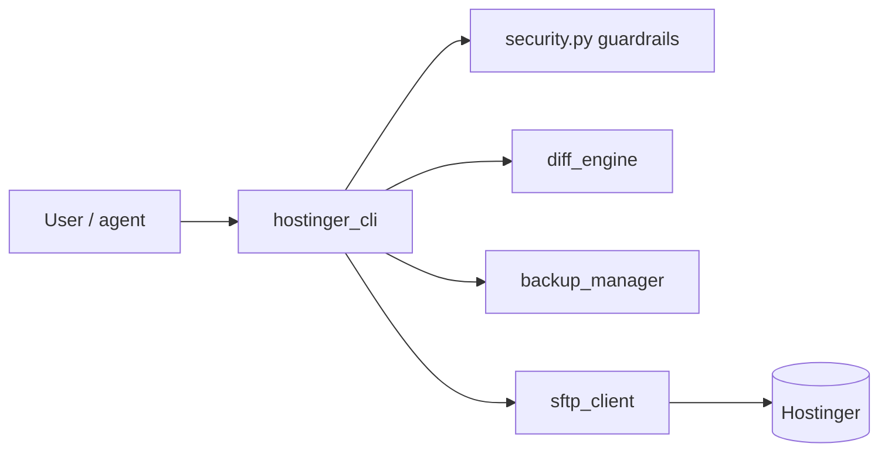

# Hostinger SFTP CLI Agent

A Python CLI for safely managing Hostinger hosting files over SFTP/SSH. Built with guardrails because an AI agent may drive it: every write is confined to allowed roots, critical files are immutable, and nothing goes out without a diff and explicit confirmation.

**Stack:** Python, Paramiko, pytest.

## Safety design
- Root confinement (path-traversal protection) and a deny-list for secrets, keys, archives and backups.
- Pre-write flow: download, SHA-256 hash, dated local backup, colored unified diff, user confirmation.
- Concurrency check (remote file unchanged between read and write) and atomic upload via temp file + rename with size/hash verification.
- Never prints credentials; multi-domain via `--domain`.



## Run
```bash
pip install -r requirements.txt
cp .env.example .env   # fill your own host, user and key
python -m hostinger_cli --help
pytest
```

## Status
Working tool used against the author's own hosting; tests cover config, security, backup and CLI. The detailed original (Spanish) documentation is below.

---

# Hostinger SFTP CLI Agent

Agente local por línea de comandos (CLI) en Python para administrar archivos de hosting en **Hostinger** de forma segura mediante **SFTP/SSH**. Diseñado para operar sobre la misma estructura de directorios que visualiza el Administrador de archivos de hPanel.

---

## Características Principales

- **Conexión SFTP Robusta**: Opera mediante Paramiko en el puerto SSH/SFTP oficial de Hostinger (`65002`).
- **Seguridad y Guardrails Estrictos**:
  - **Aislamiento de Raíces**: Todas las operaciones quedan estrictamente confinadas a las rutas definidas en `HOSTINGER_ALLOWED_ROOTS` (protección contra *Path Traversal*).
  - **Archivos Críticos Inmutables**: Prohibición explícita de modificación o sobreescritura sobre archivos sensibles (`.env`, `wp-config.php`, llaves privadas `*.pem`, `*.key`, certificados `*.crt`, backups `*.bak`, `*.tar.gz`, `*.zip`, etc.).
  - **Cero Fuga de Secretos**: No imprime contraseñas, tokens ni cadenas confidenciales en consola o registros.
  - **Flujo Pre-Escritura Seguro**:
    1. Descarga el archivo remoto actual.
    2. Calcula y valida hashes criptográficos SHA-256.
    3. Genera un backup local fechado automático antes de escribir.
    4. Muestra un diff unificado y colorizado.
    5. Solicita confirmación explícita del usuario antes de aplicar cambios.
    6. **Detección de Concurrencia**: Verifica que el archivo remoto no haya cambiado en el servidor entre la lectura y la escritura (evita sobreescrituras accidentales por terceros).
    7. **Subida Atómica**: Sube a un archivo temporal oculto en el servidor y lo renombra de forma atómica (`posix_rename` o rename validado) solo tras verificar integridad de tamaño y hash.
- **Soporte Multi-Dominio**: Configurado para un dominio inicial (`grupomonoga.com`) con capacidad para alternar entre múltiples dominios con el parámetro `--domain` / `-d`.

---

## Estructura del Proyecto

```text
agente-hostinger/
├── .env.example              # Plantilla pública sin secretos
├── .env                      # Configuración local (ignorado por Git)
├── .gitignore                # Protege .env, backups/ y artefactos
├── requirements.txt          # Dependencias (paramiko, python-dotenv, click, etc.)
├── README.md                 # Documentación de uso y arquitectura
├── hostinger_cli/
│   ├── __init__.py
│   ├── __main__.py          # Punto de entrada para ejecución modular
│   ├── config.py            # Carga de .env, validación y soporte multi-dominio
│   ├── security.py          # Reglas de protección, hashing SHA-256 y path traversal
│   ├── sftp_client.py       # Cliente SFTP Paramiko con escrituras atómicas
│   ├── backup_manager.py    # Generador de backups locales fechados y manifiesto JSONL
│   ├── diff_engine.py       # Motor de diff unificado y coloreado
│   └── cli.py               # Comandos CLI (list, get, diff, backup, put, edit, status)
└── tests/
    ├── __init__.py
    ├── test_security.py     # Pruebas de path traversal, archivos protegidos y hashes
    ├── test_config.py       # Pruebas de carga de configuración y dominios
    ├── test_backup.py       # Pruebas de backups y diffs
    └── test_cli.py          # Pruebas de comandos CLI y workflows atómicos
```

---

## Instalación y Configuración

### 1. Requisitos Previos

- Python 3.10 o superior.
- Credenciales de acceso SSH / SFTP en Hostinger hPanel:
  - **Host / IP**: Visible en `SSH Access` en hPanel.
  - **Puerto**: `65002` (puerto SFTP de Hostinger).
  - **Usuario**: Tu usuario SSH / FTP (ej. `u000000000`).
  - **Contraseña**: Contraseña dedicada creada para el agente (distinta de la de hPanel).
  - **Ruta Raíz**: Carpeta `public_html` del dominio.

### 2. Instalar Dependencias

```powershell
pip install -r requirements.txt
```

### 3. Configurar `.env` Local

Copia el archivo `.env.example` a `.env` (o edita el `.env` local ya generado) y coloca tu contraseña de agente:

```env
HOSTINGER_SFTP_HOST=203.0.113.10
HOSTINGER_SFTP_PORT=65002
HOSTINGER_SFTP_USERNAME=u000000000
HOSTINGER_SFTP_PASSWORD=<tu_contraseña_exclusiva_de_agente>

HOSTINGER_TARGET_DOMAIN=grupomonoga.com
HOSTINGER_ALLOWED_ROOTS=/home/u000000000/domains/grupomonoga.com/public_html
HOSTINGER_BACKUP_DIR=./backups
HOSTINGER_SSH_HOST_KEY_FINGERPRINT=
```

> **Aviso de Seguridad**: Nunca confirmes o subas el archivo `.env` a ningún repositorio de código. Está explícitamente ignorado en `.gitignore`.

---

## Uso de la CLI

Puedes ejecutar el agente utilizando:

```powershell
python -m hostinger_cli [COMANDO] [ARGUMENTOS...]
```

### Comandos Disponibles

| Comando | Descripción |
| :--- | :--- |
| `status` | Verifica la conexión SFTP, huella SSH y valida la ruta raíz sin mostrar contraseñas. |
| `list [ruta]` | Lista archivos y carpetas remotas (permisos, tamaño, fecha de modificación). |
| `get <remoto> [local]` | Descarga un archivo del hosting al equipo local de forma segura. |
| `diff <remoto> <local>` | Muestra un diff unificado entre la versión remota y el archivo local. |
| `backup <remoto>` | Genera un respaldo local fechado y registra su hash en el manifiesto. |
| `put <local> <remoto>` | Flujo seguro de subida: genera diff, pide confirmación, respalda y sube atómicamente. |
| `edit <remoto>` | Descarga el archivo, abre tu editor configurado, muestra diff al guardar y aplica cambios de forma atómica previa confirmación. |
| `backups` | Muestra el historial de backups locales guardados en `backups_manifest.jsonl`. |

---

### Ejemplos de Uso

#### 1. Probar Conexión
```powershell
python -m hostinger_cli status
```

#### 2. Listar Archivos en `public_html`
```powershell
# Listar directorio raíz del dominio activo
python -m hostinger_cli list

# Listar un subdirectorio específico
python -m hostinger_cli list wp-content/plugins
```

#### 3. Descargar un Archivo
```powershell
# Descarga a ./downloads/index.php
python -m hostinger_cli get index.php

# Descarga a una ruta local específica
python -m hostinger_cli get index.php ./mis_archivos/index.php
```

#### 4. Comparar Diferencias (Diff)
```powershell
python -m hostinger_cli diff index.php ./nuevo_index.php
```

#### 5. Subir Archivo con Verificación y Backup Previo
```powershell
# Mostrará el diff y pedirá confirmación explícita [y/N]
python -m hostinger_cli put ./index.php index.php

# Modo automatizado (saltea confirmación interactiva)
python -m hostinger_cli put ./index.php index.php --yes
```

#### 6. Editar Archivo Directamente
```powershell
python -m hostinger_cli edit index.php
```
Abre automáticamente tu editor (VS Code con `code --wait`, `notepad`, o `$EDITOR`). Si realizas cambios y guardas, la CLI muestra el diff y te pide confirmación antes de subirlo atómicamente.

#### 7. Trabajar con Múltiples Dominios
Puedes especificar qué dominio gestionar mediante la opción `--domain` o `-d`:
```powershell
python -m hostinger_cli --domain staging.grupomonoga.com list
```

---

## Ejecución de Pruebas Unitarias

El proyecto cuenta con una suite completa de pruebas unitarias automatizadas:

```powershell
python -m pytest -v
```

Todas las pruebas validan:
- Rechazo de rutas fuera del directorio raíz (*Path Traversal Protection*).
- Bloqueo de escritura en archivos de configuración, credenciales, certificados y backups.
- Detección de colisiones de concurrencia al subir archivos.
- Encriptación y hashing SHA-256.
- Enmascaramiento de contraseñas y secretos en consola.
